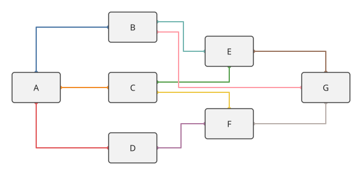

# connector-routing

[](https://crates.io/crates/connector-routing)
[](https://docs.rs/connector-routing)
[](https://github.com/sunsided/connector-routing/actions/workflows/ci.yml)
[](https://codecov.io/gh/sunsided/connector-routing)
[](https://crates.io/crates/connector-routing)
[](https://github.com/sunsided/connector-routing#license)
[](https://github.com/rust-secure-code/safety-dance/)

Global connector routing: many orthogonal connectors at once with bend, length and crossing
costs, negotiated congestion and rip-up and reroute.

The crate routes connectors around rectangular obstacles, as diagram editors, schematic tools
and cable-plan generators need: optimal single routes, many routes negotiating channel
capacity, crossing reduction, and a final placement that separates shared stretches, plus
hyperedges (Steiner trees for nets with more than two ports) and any-angle routing through
sleeves or poly-lines for when the lines need not be orthogonal. All geometry is exact integer arithmetic, so results are reproducible and free
of floating-point robustness issues; the crate is `no_std` with `alloc`.



The drawing above is the output of `cargo run --example svg`.

## Who this is for

- Diagram and graph editors (flowcharts, UML, node editors, architecture diagrams) that need
  connectors which avoid the boxes, bend rarely, cross rarely and do not lie on top of each
  other, and that should update incrementally when the user drags a box.
- Schematic and EDA-style tools, and generators for cable or wiring plans, where many nets
  share narrow channels and nets with more than two ports become Steiner trees.
- Layout engines that run their own placement: the nudging step solves its separation
  constraints exactly, and also exports them as data for an engine that places segments
  itself.
- If you need the plain shortest path on a general graph, use
  [heuristic-search](https://github.com/sunsided/heuristic-search); for agents that move
  over time and must not meet at all,
  [mapf-search](https://github.com/sunsided/mapf-search); for Pareto fronts on graphs other
  than routing scenes,
  [multiobjective-search](https://github.com/sunsided/multiobjective-search).

## Installation

```sh
cargo add connector-routing
```

Or in `Cargo.toml`:

```toml
[dependencies]
connector-routing = "0.1"
```

## Scope

Orthogonal routing:

- Exact geometry, routing graph, orthogonal visibility graph (Wybrow, Marriott and Stuckey 2009) with a routing frame and port stubs, incremental updates for added, moved and removed obstacles and ports
- Single connector: A* over `(vertex, heading)` with an exact free-space bend estimate; weighted and exact lexicographic length/bend objectives; checked against brute force on the unit grid
- 1-bend visibility graph search (Marriott, Stuckey and Wybrow 2014), opt-in: tests show it is not exact in general, so the OVG search is the default
- Global routing: PathFinder negotiated congestion over channel capacities, rip-up and reroute, crossing penalties, deterministic net order
- Reports of the connectors a scene change invalidates or may improve
- Path ordering in shared channels, required crossings, crossing reduction
- Nudging: scan-line separation constraints (exported as data) solved exactly as difference constraints with water-filling, no LP; or VPSC projection of desired positions
- Pipeline of arXiv 2309.01671: port assignment, visibility or channel routing graph, routing, crossing reduction, ordering, constrained or full nudging (boxes move and grow)
- Hyperedges (Wybrow et al. 2012): Steiner trees by both heuristics with segment-shifting improvement, nudged like connectors
- Pareto fronts over length, bends and crossings (feature `multi-objective`, via `multiobjective-search`)

Any-angle routing:

- Sleeve routing (arXiv 2605.17498): exact constrained Delaunay triangulation, dual-graph Dijkstra, funnel algorithm, vertex-cover batching, exits along walls between touching obstacles
- Incremental poly-line routing (Wybrow et al. 2005): visibility and invisibility graphs, rerouting reports, hidden-region pruning, segment, angle and crossing penalties

See [`docs/design.md`](https://github.com/sunsided/connector-routing/blob/main/docs/design.md) for the models, the deviations from the papers that testing found, and the paper table.

## Example

```rust
use connector_routing::{Connector, DirSet, Point, Port, Rect, Scene, global, nudge};

let mut scene = Scene::new();
let boxes = [Rect::new(0, 0, 20, 10), Rect::new(60, 0, 80, 10)];
for b in boxes {
    scene.add_obstacle(b).unwrap();
}

let a = scene.add_port(Port::new(Point::new(20, 5), DirSet::RIGHT)).unwrap();
let b = scene.add_port(Port::new(Point::new(60, 5), DirSet::LEFT)).unwrap();
let connectors = [Connector { source: a, target: b }];
let routing = global::route_all(&scene, &connectors, &global::Config::default()).unwrap();
let nudged = nudge::nudge(scene.graph(), &boxes, &routing.routes, &nudge::Config::default());
assert_eq!(nudged.routes[0], [Point::new(20, 5), Point::new(60, 5)]);
```

## Performance

On 192 boxes and 300 connectors (`cargo bench --bench routing`): the visibility graph has about 9,500 vertices and builds in 7 ms, global routing takes about 0.9 s, nudging 0.3 s, and the whole pipeline 1.3 s.

## MSRV

The minimum supported Rust version is 1.86 (`rust-version` in `Cargo.toml`), for every
feature. It is a signal, not a contract: raising it is a minor release, never a patch
release. Tests and benches may need a newer Rust.

## Contributing

See [CONTRIBUTING.md](https://github.com/sunsided/connector-routing/blob/main/CONTRIBUTING.md).

## License

Licensed under either of

- Apache License, Version 2.0 ([LICENSE-APACHE](https://github.com/sunsided/connector-routing/blob/main/LICENSE-APACHE))
- MIT license ([LICENSE-MIT](https://github.com/sunsided/connector-routing/blob/main/LICENSE-MIT))

at your option.

Unless you explicitly state otherwise, any contribution intentionally submitted for inclusion
in this work by you, as defined in the Apache-2.0 license, shall be dual licensed as above,
without any additional terms or conditions.
